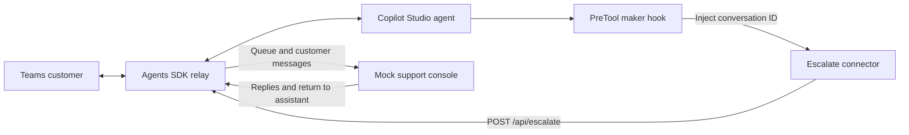
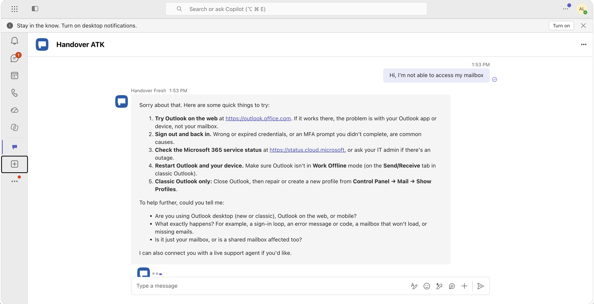
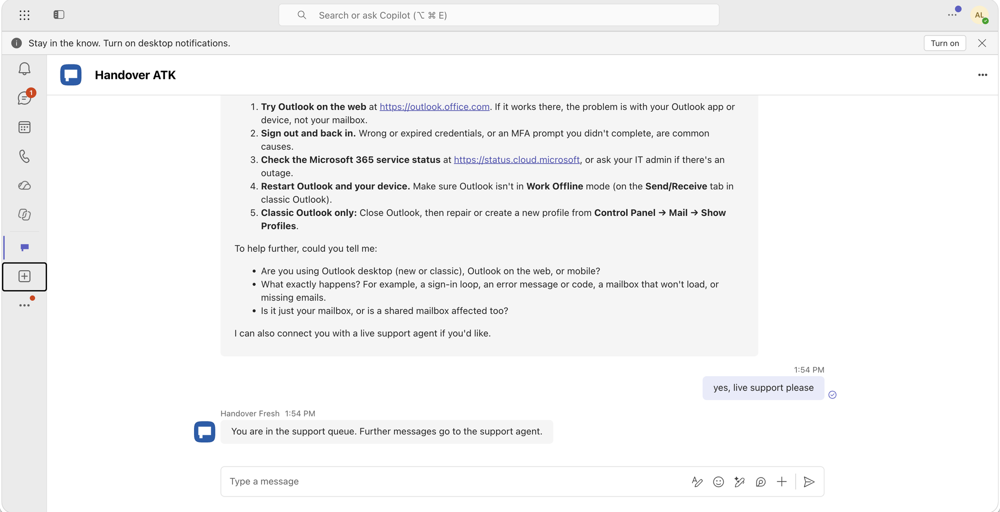
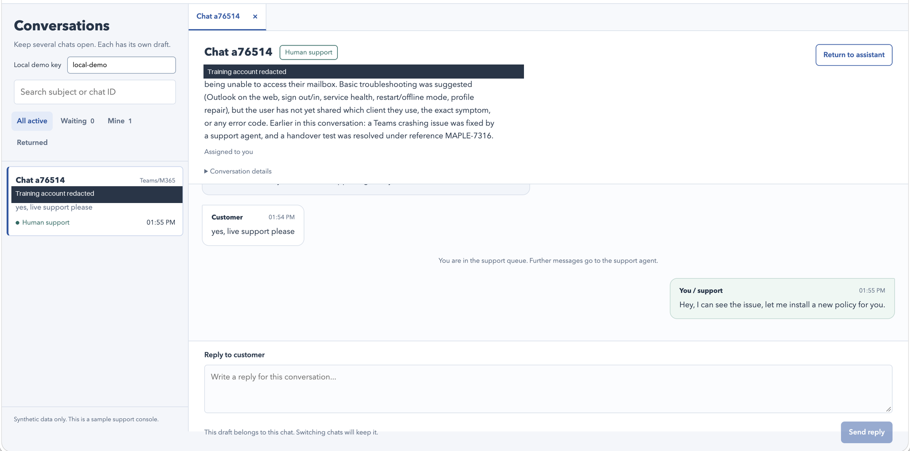
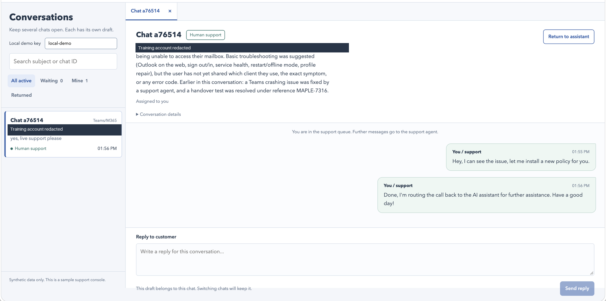
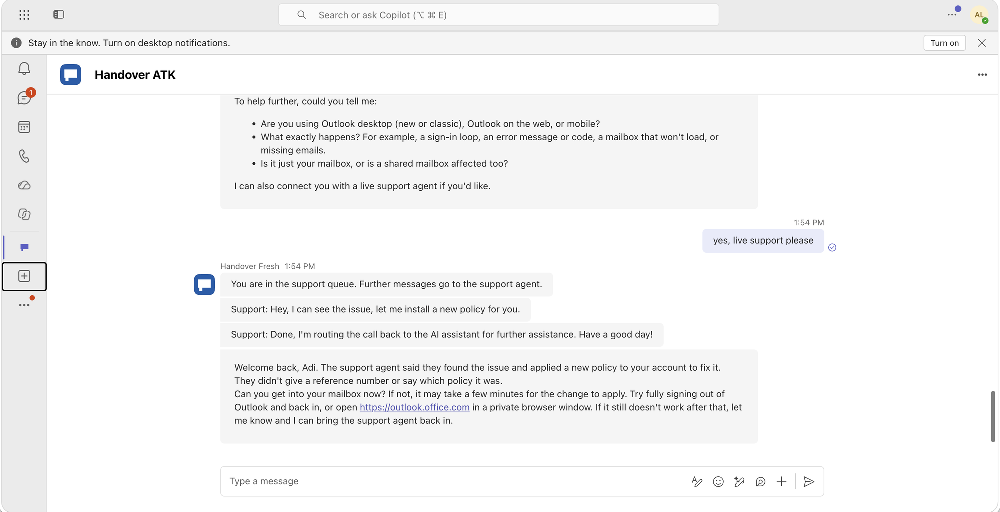

# Live agent handover pattern for Microsoft Copilot Harness agents

## Contents

- [Introduction](#introduction)
- [Fastest path to deploy](#fastest-path-to-deploy)
- [Architecture](#architecture)
- [Screenshots](#screenshots)
- [Notes](#notes)
- [Installation details](#installation-details)

## Introduction

This sample enables a **Copilot Studio agent of type Microsoft Copilot Harness** to hand a conversation to a **human support representative**, then resume with the context of that human conversation. It includes an Agents SDK relay, an escalation connector and maker hook, and a mock support chat app.

{: .note }
> This is an interim sample, not the final integration pattern. We expect better ways to share channel data with a Copilot Studio agent and receive it back through a webhook or other mechanisms, potentially including events. **There is no current timeline for these improvements.**

## Fastest path to deploy

Use the **local relay + tunnel** with Teams.

### Prerequisites

- Node.js 24 LTS and npm.
- Azure CLI and an Azure subscription with resource-deployment and role-assignment permissions.
- Power Platform CLI (`pac`), signed into that same environment.
- Microsoft 365 Agents Toolkit (ATK) 1.1.19, signed into Microsoft 365.
- Dev tunnels CLI, signed in.
- A Copilot Studio environment with the **Microsoft Copilot Harness** agent type and maker hooks enabled, and permission to import solutions.

Use the **same test tenant** for Azure, Copilot Studio, ATK and Teams. See the [installation guide](./install#prerequisites) for CLI installation and sign-in details.

### 1. Import the solutions

In [Power Apps](https://make.powerapps.com), select your target environment and open **Solutions > Import solution**. Import these packages in order:

1. [Connector package](./solution/CopilotStudioHandoverConnector_1_0_0_0.zip?raw=true).
2. [Agent package](./solution/CopilotStudioHandover_1_0_0_0.zip?raw=true), selecting or creating the connector's **No authentication** connection when prompted.

Two solutions are required because the [connector must be imported before its connection reference](https://learn.microsoft.com/en-us/connectors/custom-connectors/customconnectorssolutions#known-limitations). The agent package includes the Escalate tool and scoped PreTool maker hook. The unpacked solutions are in `sourcecode/`. See the [import steps](./install#1-import-the-solutions).

The imported Copilot Studio agent's **schema name is `cpshnd_handover`**.

### 2. Start the relay

From this sample directory:

```sh
npm ci
npm run configure -- --subscription YOUR_SUBSCRIPTION_GUID --environment-id YOUR_ENVIRONMENT_GUID --schema-name cpshnd_handover
node scripts/setup.mjs identity --approve-identity
npm run local -- --approve-azure
```

### 3. Connect the agent and install in Teams

Keep that terminal running. In Power Apps, edit the imported **Handover escalation** custom connector and set **General > Host** to the printed public tunnel hostname, without `https://` or a path. Select **Update connector**, then publish the imported agent in Copilot Studio.

**Escalate and its scoped PreTool hook are already wired in the solution.** Do not recreate or rebind them.

In another terminal, distribute the Teams package through ATK:

```sh
npm run install:teams -- --target local --approve-install
```

Open the printed Teams link and complete **Add** and any sign-in or consent prompts.

### 4. Open the mock support console

The `npm run local -- --approve-azure` command in step 2 serves **both the relay and the mock support console**. There is no separate console process or build. Keep it running and open this address in a browser on the same machine:

```text
http://127.0.0.1:3978/support.html
```

In Teams, ask to speak to a human. In the console, claim the queued chat, send a reply, then select **Return to assistant**. The assistant resumes in Teams with the human conversation's context. The console needs no sign-in and is not exposed through the tunnel.

For a credential-free browser mock instead, run `npm ci` and `npm run dev`, then open `http://127.0.0.1:3978/` for customer chat and `/support.html` for the console. This separate mode does not call a real Studio agent; do not run it alongside the live relay on the same port.

## Architecture



The hook supplies the authoritative **Studio conversation ID**. The relay maps it to the customer's Teams conversation; they are not the same ID. On handback, the relay sends the human transcript into the **original Studio conversation**, and the assistant immediately resumes.

The relay persists conversation mappings, handover state and message history in a local file for local hosting, or **Azure Blob Storage** for Azure hosting.

## Screenshots

The sequence shows assistant support, human handover and the assistant resuming with the human conversation's context. Account details are redacted. The **Local demo key** field visible in these older captures has since been removed.

**1. The Copilot Studio agent helps the customer in Teams.**



**2. The customer requests a human and enters the support queue.**



**3. The human support representative claims the chat and replies from the mock console.**



**4. The human support representative wraps up and returns the chat to the assistant.**



**5. The Copilot Studio agent resumes with context from the human conversation.**



## Notes

- **Microsoft 365 Copilot Chat is unverified**, including human replies and handback in the existing conversation. Teams personal chat has been tested with a local relay and tunnel.
- **Azure-hosted deployment is unverified.** The quickest tested hosting option is the local relay and tunnel.
- **This is a demo architecture, not a production contact-center solution.** Use synthetic data only. The escalation webhook and mock support console intentionally have no authentication. The local tunnel excludes the console; the Azure option exposes it publicly.
- **Secure escalation before production:** authenticate the connector and webhook, authorize access to each conversation, and add replay protection and rate limiting. A conversation ID is not a credential.
- **Secure the support console:** require representative sign-in, restrict transcript access and support actions to authorized representatives, and audit those actions.
- **Harden operations and data handling:** validate recovery and concurrent access across instances, monitor failed message delivery, rotate credentials, and define transcript retention and deletion policies. Customer delegated sign-in and Bot channel authentication are already enabled.

## Installation details

See the [detailed installation guide](./install) for solution import, connector host configuration, authentication, deployment options and troubleshooting.
