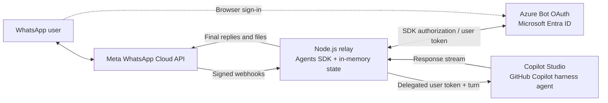
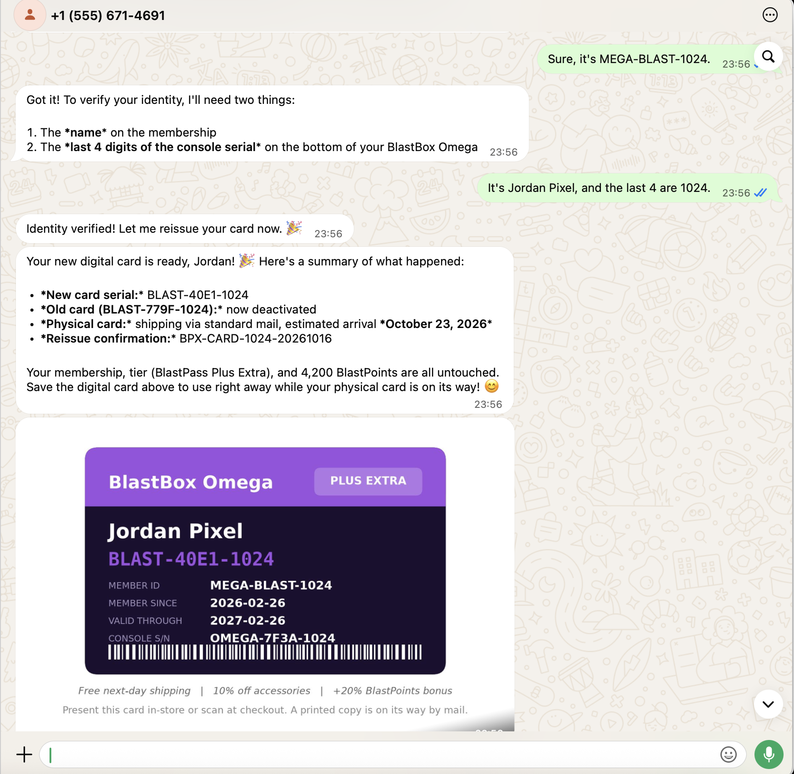

# WhatsApp for GitHub Copilot harness agents

## Why this sample exists

Copilot Studio does not currently provide a built-in WhatsApp channel for agents using the **GitHub Copilot harness (GHCP)**. Azure Communication Services (ACS) Advanced Messaging with WhatsApp is also [scheduled to retire on September 30, 2028](https://learn.microsoft.com/en-us/azure/communication-services/acs-retirement-and-breaking-changes-guide).

This sample bridges that gap by connecting **Meta's WhatsApp Cloud API directly to a published harness agent**, with delegated user sign-in through the Microsoft 365 Agents SDK. It does not depend on ACS or add another LLM.

## How it works

1. A small Node.js relay verifies Meta's signed webhooks and queues messages in memory, processing each sender's messages in order of admission.
2. The Agents SDK handles sign-in through Azure Bot OAuth and Microsoft Entra ID. The agent runs under the **signed-in user's identity**, not the relay's bot identity.
3. Each sender has separate authentication state and a separate Copilot Studio conversation. Follow-up messages reuse only that sender's session; completed replies go back through Meta. Internal streaming, reasoning, and tool traces are not forwarded.



{: .important }
> This is an experimental, single-process sample, not a production channel. Text sign-in and follow-up replies have been exercised locally; full media coverage and other [acceptance checks](docs/deployment#live-acceptance-checklist-partially-completed) remain unverified.

### Example conversation

A membership-card reissue conversation with a text response and a card image returned in WhatsApp.



## Run it locally

Install the tools needed for your chosen path:

| Dependency | Needed for | Installation |
| --- | --- | --- |
| Node.js + npm | All commands; use **22.17+ (22.x) or 24.x** | [Install Node.js](https://nodejs.org/en/download) (includes npm) |
| Dev Tunnel CLI | Local hosting | [Install Dev Tunnel CLI](https://learn.microsoft.com/en-us/azure/developer/dev-tunnels/get-started) |
| Azure CLI | Bot/OAuth provisioning or reuse validation, and Azure hosting | [Install Azure CLI](https://learn.microsoft.com/en-us/cli/azure/install-azure-cli) |
| Bicep CLI | Azure hosting only | [Install through Azure CLI](https://learn.microsoft.com/en-us/azure/azure-resource-manager/bicep/install#azure-cli): `az bicep install` |

### 1. Prepare the sample

From the repository root:

```bash
cd extensibility/agents-sdk/whatsapp-relay
npm ci
```

Create `.env` from [`.env.example`](https://github.com/microsoft/CopilotStudioSamples/blob/main/extensibility/agents-sdk/whatsapp-relay/.env.example), or keep your existing configured file. Save the values from the next steps there and keep this file private.

### 2. Configure Meta

In the [Meta App Dashboard](https://developers.facebook.com/apps/), create or select an app with the **Connect with customers through WhatsApp** use case. Open **Quickstart > Start using the API > API Setup**, select the test **From** number, and add and verify your own WhatsApp number as a **To** recipient.

Select **Generate access token**, then fill these `.env` values:

| Setting | Where to get the value |
| --- | --- |
| `META_ACCESS_TOKEN` | The temporary access token from **API Setup**. |
| `META_PHONE_NUMBER_ID` | **Phone number ID** for the test number in **API Setup**. |
| `META_WABA_ID` | **WhatsApp Business Account ID** in **API Setup**. |
| `META_APP_SECRET` | **App settings > Basic > App secret** in the same app. |
| `META_VERIFY_TOKEN` | A long random string you generate for webhook verification. |
| `META_GRAPH_VERSION` | The Graph API version shown in your app's API Setup requests. |

Temporary tokens expire; generate a fresh one when needed. See [Meta's setup walkthrough](https://developers.facebook.com/documentation/business-messaging/whatsapp/get-started) for the dashboard steps.

### 3. Publish the Copilot Studio agent

Publish the GitHub Copilot harness agent and grant the test user access.

### 4. Configure the agent endpoint

1. Record the agent's schema name and environment GUID.
2. For production/First Release, remove dashes from the environment GUID, lowercase it, and build the hostname: `<first-30-hex>.<last-2-hex>.environment.api.powerplatform.com`.
3. Set the following entries in `.env`, replacing `<environment-host>` and `<schema>`:

```dotenv
GHCP_DIRECT_CONNECT_URL=https://<environment-host>/copilotstudio/agenticruntime/3p/dataverse-backed/authenticated/bots/<schema>?api-version=1
GHCP_CLOUD=Prod
```

Keep `?api-version=1` and use the bot base URL without `/conversations`. See [endpoint configuration](docs/deployment#4-published-ghcp-agent) for other clouds.

**This endpoint is experimental and may change in future releases.**

### 5. Provision Azure sign-in

For existing Bot/OAuth resources, follow the [reuse path](docs/deployment#optional-auth-provisioning). For new resources, choose a tenant, subscription, resource group, region, and Bot name. Leave the Bot client IDs/secrets empty in `.env`, then run:

```bash
az login --tenant "<tenant-guid>"
npm run setup:auth -- --tenant "<tenant-guid>" --subscription "<subscription-guid>" --group "rg-relay-auth" --location "westeurope" --bot "my-relay-bot"
```

This command creates the Azure Bot, Entra apps, and `mcs` OAuth connection, with generated settings saved in `.env`.

### 6. Approve and verify sign-in

In Entra ID, complete required tenant consent for the sign-in application configured on the Bot's `mcs` OAuth connection. In the Azure Bot portal, open that connection and run **Test Connection**.

### 7. Start the relay

```bash
npm run start:local
```

Complete Dev Tunnel sign-in if prompted. Review and approve the Meta callback destination when prompted, then wait for the relay's readiness message. Keep the terminal running.

### 8. Verify a conversation

From the verified recipient number, message the Meta test number. Open **Sign in**, complete Microsoft sign-in, and send the six-digit code back in WhatsApp. Confirm that the agent answers the original request, then send a follow-up message.

Stop with Ctrl+C; follow the [cleanup instructions](docs/deployment#ownership-failures-and-scoped-cleanup) to remove the retained tunnel registration or change the callback.

**Deploy to Azure:** Follow the [Azure deployment guide](docs/deployment#lightweight-azure-deployment) with the same `.env` configuration. Hosting uses a paid B1 App Service plan.

## Before making it enterprise-ready

This sample was built to demonstrate that the integration pattern is possible and works. To make it enterprise-ready, you would need to address the following concerns:

- **Durable admission:** acknowledge webhooks only after saving work to a broker such as Service Bus.
- **Restart recovery and scale-out:** preserve each user's isolated authentication and conversation state across restarts, and let different workers safely resume that user's session.
- **Recoverable outcomes:** durable deduplication, an outbound ledger, controlled retries, and reconciliation of uncertain agent actions or sends. Queues do not guarantee exactly-once external effects.
- **Security and operations:** managed secrets and rotation, protected webhook ingress, media scanning/retention, delivery monitoring, and WhatsApp policy compliance.
- **End-to-end validation:** cross-user authorization, each media modality, and failure/recovery and scale-out behavior.

See the **[enterprise architecture guide](docs/enterprise-readiness)** for the design choices and trade-offs. These capabilities are not implemented in this sample. For configuration, runtime limits, and verification details, use the **[setup and deployment guide](docs/deployment)**.
