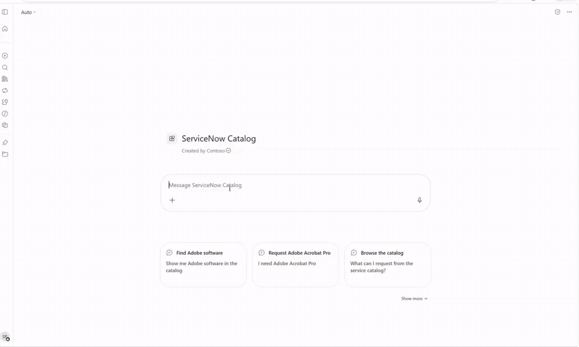
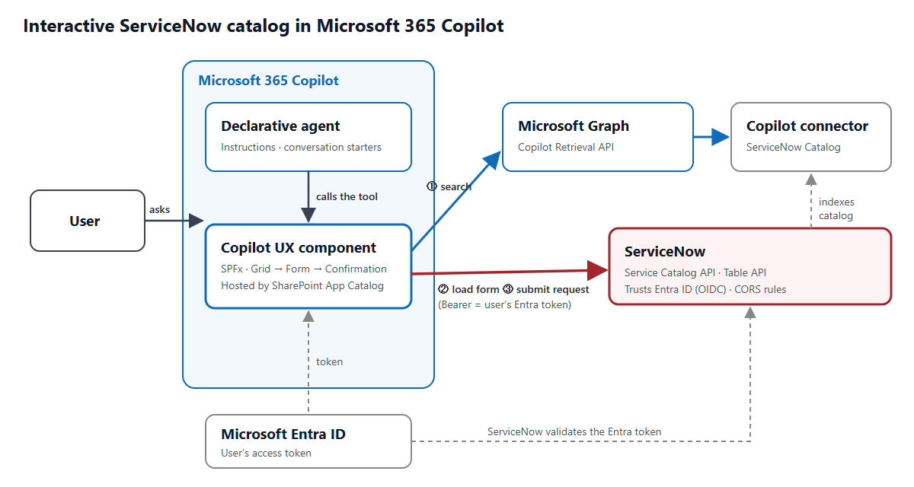

# ServiceNow catalog in Microsoft 365 Copilot

A declarative agent with a **SharePoint Framework (SPFx) Copilot UX component**. Users ask Copilot for something ("I need video editing software"), and the agent does the rest:

1. Finds matching items in the **ServiceNow Catalog Copilot connector**, using the Copilot Retrieval API.
2. Shows the matches in an interactive **grid** with a title, a description and a **Select** button.
3. Opens that item's **request form**, built dynamically from the item's ServiceNow variables (text, choice, checkbox, date, reference and so on).
4. **Submits the request** to ServiceNow as the signed-in user and shows the request number.





The component calls ServiceNow **directly from the browser** with the user's Microsoft Entra ID token. ServiceNow trusts Entra ID as an OIDC provider, and CORS rules allow the call. You don't need a gateway or a backend service. A more detailed diagram is in [docs/architecture-detailed.png](docs/architecture-detailed.png).

> This is a sample for learning and demos. Review security, error handling and support requirements before you use it in production.

---

## Prerequisites

| Area | What you need |
|---|---|
| **Microsoft 365** | A tenant with **Microsoft 365 Copilot** licenses for the users. A **SharePoint tenant-wide App Catalog**. Admin roles: **SharePoint Administrator** (to deploy and approve API access) and **Teams/Copilot admin**, or permission to upload custom apps. |
| **Copilot connector** | The **ServiceNow Catalog** Copilot connector, set up and synced (Microsoft 365 admin center > Copilot > Connectors). You need its **Connection ID**. |
| **Microsoft Entra ID** | Permission to create an app registration (**Application Developer** or higher). |
| **ServiceNow** | An instance (a free [developer instance](https://developer.servicenow.com) works for learning purpose) and an **admin** account. Every Copilot user needs a ServiceNow user whose **email equals their Microsoft 365 sign-in name (UPN)**. |
| **Dev machine** | [Node.js](https://nodejs.org) **22, 24 or 26** (LTS). [Azure CLI](https://aka.ms/installazurecliwindows). PowerShell 5.1 or 7. Optional: [Microsoft 365 Agents Toolkit](https://aka.ms/teams-toolkit). |

---

## Setup

### 1. Get the connector Connection ID

In the Microsoft 365 admin center, open **Copilot > Connectors**, then open your ServiceNow Catalog connection and copy its **Connection ID**.

The component expects the connector's default schema properties: `SysId`, `Name`, `ShortDescription`, `Category`, `Type` and `AccessUrl`. If yours differ, update `CONNECTOR_FIELDS` in `settings.ts`.

### 2. Register the Entra ID app

```powershell
az login --tenant <your-tenant>.onmicrosoft.com --allow-no-subscriptions
cd scripts
.\Register-EntraApp.ps1                       # optional: -AppName "Your name"
```

The script creates an app with the Application ID URI `api://<appId>`, a `user_impersonation` scope, and **v2 access tokens**. Note the **Tenant ID** and the **App (client) ID** that it prints.

<details><summary>Manual alternative (Entra admin center)</summary>

1. Open **App registrations > New registration**. Name it `ServiceNow Catalog Copilot API` and choose **Single tenant**.
2. In **Expose an API**, set the Application ID URI to `api://<appId>`, then add the scope `user_impersonation` with **Admins and users** consent.
3. In **Manifest**, set `"requestedAccessTokenVersion": 2` (shown as `accessTokenAcceptedVersion` in the older manifest view).
</details>

### 3. Configure ServiceNow

```powershell
.\Configure-ServiceNow.ps1 `
  -InstanceUrl      https://<instance>.service-now.com `
  -TenantId         <tenant-id> `
  -AppId            <app-client-id> `
  -SharePointOrigin https://<tenant>.sharepoint.com
```

You're prompted for ServiceNow admin credentials. The script is safe to run more than once. It creates the following:

| Record | Where in ServiceNow | Key values |
|---|---|---|
| OIDC provider configuration | System OAuth > OIDC Provider Configuration | Metadata URL `https://login.microsoftonline.com/<tenant>/v2.0/.well-known/openid-configuration`. User claim `preferred_username`. User field `email`. |
| External OIDC Provider | System OAuth > Application Registry | Client ID = **Entra app ID** (the token audience). |
| CORS rule: Service Catalog API | System Web Services > REST > CORS Rules | Domain = SharePoint origin. GET and POST. Headers `authorization,content-type,accept`. **Allow credentials = true.** |
| CORS rule: Table API | same | Domain = SharePoint origin. GET only (used for reference-field lookups). **Allow credentials = true.** |

> **Why the SharePoint origin?** Copilot renders the component inside a SharePoint-hosted frame (`https://<tenant>.sharepoint.com/_layouts/15/PortableComponent.aspx`), so the browser sends that origin.
> **Why Allow credentials?** ServiceNow leaves `Authorization` out of `Access-Control-Allow-Headers` unless credentials are allowed, and the browser then blocks the call.

**Users and roles.** Each user needs a ServiceNow account whose email matches their UPN. To fill **reference fields** (for example *Requested for*), users also need read access to the referenced table. A user with no roles gets `403 Insufficient rights`. The `itil` role, or a custom role with read ACLs, fixes this.

### 4. Update the code

| File | What to change |
|---|---|
| `spfx/src/copilotComponents/serviceNowCatalog/settings.ts` | `connectionId`: the connector Connection ID. `serviceNowInstanceUrl`: `https://<instance>.service-now.com`. `apiResource`: `api://<app-client-id>`. Keep `apiMode: 'direct'`. |
| `spfx/copilot/declarativeAgent.json` | `connection_id`: the same Connection ID. Optionally edit `conversation_starters` to match your catalog. |
| `spfx/config/package-solution.json` | `webApiPermissionRequests[0].resource` must equal your Entra **app display name** (the default is `ServiceNow Catalog Copilot API`). Optionally fill in `developer`. |
| `spfx/copilot/manifest.json` | `developer` (name and URLs), `name`, `description`. Optionally replace `color.png` (192×192) and `outline.png` (32×32). |
| `spfx/copilot/instruction.txt` | Optional: change how the agent decides between showing the grid and answering in text. |

### 5. Build and test locally

```powershell
cd spfx
npm install
npm run build             # runs the unit tests and creates sharepoint/solution/servicenow-catalog-copilot.sppkg
npx heft start --nobrowser
```

To test, open `https://<tenant>.sharepoint.com/_layouts/15/CopilotWorkbench.aspx`. Search for an item, select it, fill in the form and submit.
The Workbench needs the API permissions from step 6. If you haven't approved them yet, deploy and approve first, then come back to the Workbench.

### 6. Deploy

1. Upload `spfx/sharepoint/solution/servicenow-catalog-copilot.sppkg` to the **tenant App Catalog**, then select **Deploy** (it's tenant-wide; `skipFeatureDeployment` is set).
2. In the **SharePoint admin center**, go to **Advanced > API access**. **Approve** both pending requests:
   - *ServiceNow Catalog Copilot API*, `user_impersonation`
   - *Microsoft Graph*, `ExternalItem.Read.All`
3. In the App Catalog, select the app and then **Add to Teams**. This publishes the declarative agent to your organization. If your Teams admin policy requires it, allow the app in the **Teams admin center**.
4. In Microsoft 365 Copilot, open the **ServiceNow Catalog** agent and try one of the conversation starters.

> When you change the instructions or the agent definition, increase the version in `package-solution.json` and `copilot/manifest.json`, rebuild, upload the new package, run **Add to Teams** again, and start a **new chat**.

---

## Troubleshooting

| Symptom | Fix |
|---|---|
| "Can't reach https://…service-now.com from the browser" | CORS. Check that both CORS rules exist, that the domain is exactly `https://<tenant>.sharepoint.com` (no trailing slash and no `*`), and that **Allow credentials** is on. Also check that the developer instance isn't **hibernating** (wake it at developer.servicenow.com). |
| 401 from ServiceNow | Check the token mapping. The External OIDC Provider **Client ID** must equal the Entra **app ID**, and the app must issue **v2** tokens. The user must exist in ServiceNow with `email` = UPN. |
| 403 "Insufficient rights" when you type in a reference field | Give the user read access to the referenced table (for example the `itil` role for `sys_user`). |
| The grid is empty, or the agent answers in text only | Check `connectionId` (in both files), connector sync status, and that the user can see the items. Start a new chat after you redeploy. |
| "API access not approved" or the token request fails | Approve both requests in SharePoint admin center > API access. The resource name must match the Entra app display name. |
| Changes don't appear in Copilot | Increase the versions, upload again, run **Add to Teams**, and open a new chat. |

---

## Project structure

```
servicenow-catalog-copilot-sample/
├─ docs/                         demo GIF and architecture diagrams
├─ scripts/
│  ├─ Register-EntraApp.ps1      Entra app (api://<appId>, user_impersonation, v2 tokens)
│  └─ Configure-ServiceNow.ps1   OIDC provider, OIDC entity and CORS rules in ServiceNow
└─ spfx/                         SPFx 1.24 solution
   ├─ copilot/                   declarative agent: manifest, instructions, action (ai-plugin.json), icons
   ├─ config/                    package-solution.json (API permissions), serve.json
   └─ src/copilotComponents/serviceNowCatalog/
      ├─ settings.ts             ← your environment values
      ├─ ServiceNowCatalogCopilotComponent.tsx   entry point called by Copilot
      ├─ components/             CatalogGrid, CatalogItemForm, VariableField, ReferencePicker
      ├─ services/               CatalogSearchService (Retrieval API), ServiceNowService (REST)
      └─ utils/                  variable mapping, path mapping, errors
```

**ServiceNow APIs used:** `GET /api/sn_sc/servicecatalog/items/{sys_id}` (form definition), `POST …/items/{sys_id}/order_now` or `…/submit_producer` (submit), and `GET /api/now/table/{table}` (reference lookups).

---

## Alternative: API gateway mode

If you can't expose ServiceNow to browser calls, set `apiMode: 'apim'` and `apiBaseUrl` in `settings.ts`. Then put an Entra ID-protected gateway (for example **Azure API Management**) in front of ServiceNow. The gateway exposes the following paths and forwards them with its own ServiceNow credentials:

| Gateway path | ServiceNow API |
|---|---|
| `GET  /catalog/items/{sysId}` | `/api/sn_sc/servicecatalog/items/{sysId}` |
| `POST /catalog/items/{sysId}/order_now` | `/api/sn_sc/servicecatalog/items/{sysId}/order_now` |
| `POST /catalog/items/{sysId}/submit_producer` | `/api/sn_sc/servicecatalog/items/{sysId}/submit_producer` |
| `GET  /reference/{table}?q=` | `/api/now/table/{table}` |


