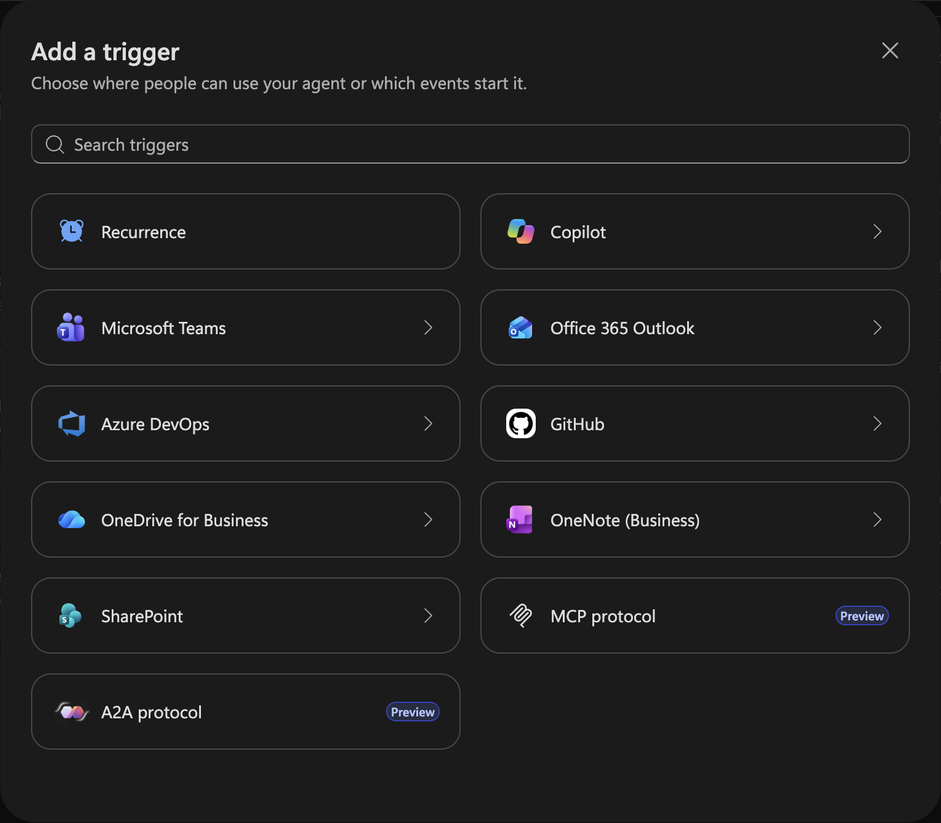
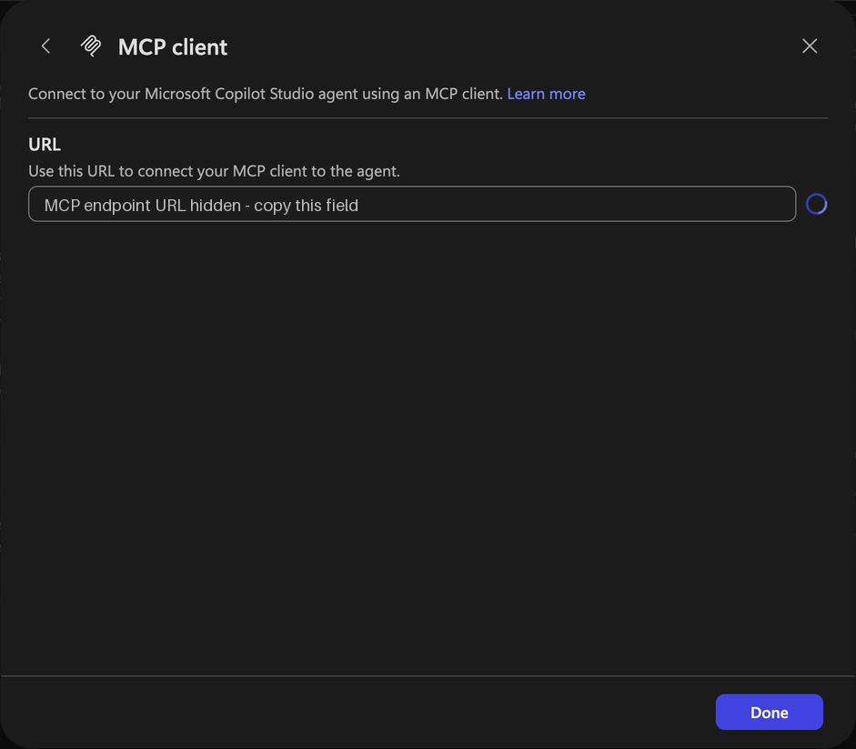
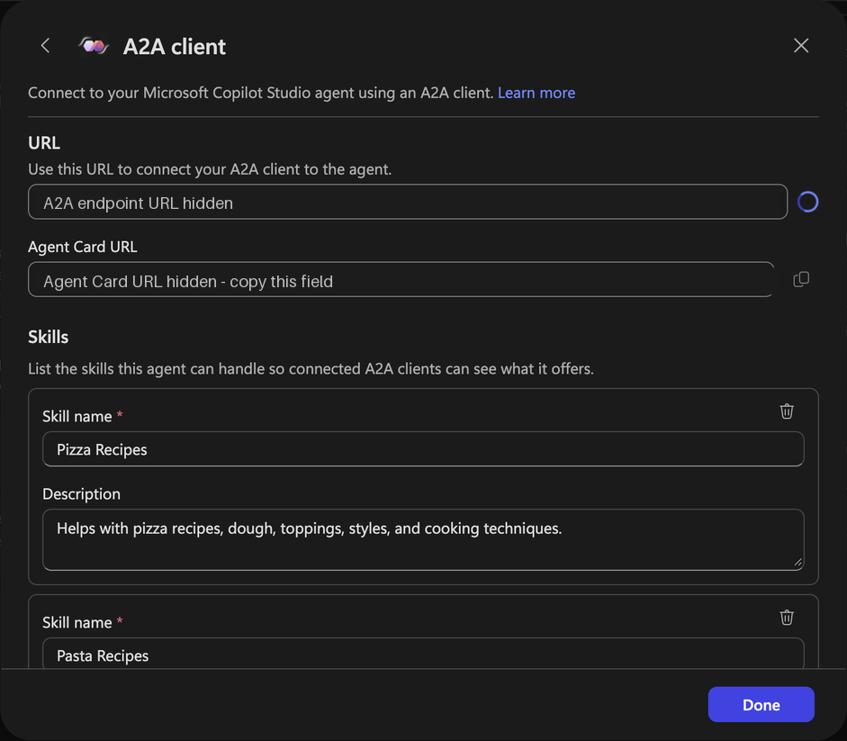

# Chat with Copilot Studio over MCP and A2A

This sample includes a cooking agent solution and two Python console clients using the official [A2A SDK](https://github.com/a2aproject/a2a-python) and [MCP SDK](https://github.com/modelcontextprotocol/python-sdk). The agent helps with pizza, pasta, and bread, with public recipe websites as knowledge sources.

- **A2A:** discovers the agent's skills and displays streamed responses.
- **MCP:** discovers tools and calls Copilot Studio's `send-message` tool.

Each turn sends the new message and the server's conversation ID. Copilot Studio maintains conversation history. Authentication and display handling are separate from the client code.

## Prerequisites

- Python 3.11 or later and a browser for sign-in.
- On Linux, libsecret/PyGObject and an available Secret Service session for encrypted sign-in caching.
- An early-release Power Platform environment with Copilot Studio and the **MCP protocol** and **A2A protocol** triggers.
- Permission to import solutions and publish agents in that environment.
- Permission to create an Entra app registration, or administrator assistance.

{: .note }
> These channels are in preview. Agent invocations can consume Copilot Credits.

## Import the included agent

1. Download [CopilotStudioProtocolClients_1_0_0_0.zip](https://github.com/microsoft/CopilotStudioSamples/raw/refs/heads/main/extensibility/copilotstudio-protocol-clients/solution/CopilotStudioProtocolClients_1_0_0_0.zip) from this sample's `solution/` folder.
2. Open [Power Apps](https://make.powerapps.com), select your target environment, and choose **Solutions > Import solution**. Import the ZIP.
3. Open **A2A MCP Sample** in [Copilot Studio](https://copilotstudio.microsoft.com) in the same environment. Check the three website knowledge sources and **Publish** the agent.
4. If another account will run the clients, give that account access to the agent.

The unmanaged solution includes the agent's instructions, three A2A skills, three website knowledge sources, and feedback settings. It has no connection references or environment variables to configure. Channel URLs and Entra registration are configured in your target environment.

## Find the endpoints

Open the imported **A2A MCP Sample** agent in Copilot Studio. On the **Build** tab, select **+** beside **Triggers**.



Select **MCP protocol**. In the **MCP client** dialog, copy **URL** into `MCS_MCP_URL`, then select **Done**.



Open **Triggers > +** again and select **A2A protocol**. In the **A2A client** dialog, copy **Agent Card URL** into `MCS_A2A_CARD_URL`, then select **Done**. The sample uses the **Agent Card URL**, which is shown separately from **URL**.



The screenshots have their URLs redacted; copy the values from your imported agent. If either trigger is absent, check the environment's early-release eligibility. See the [channel setup guide](https://learn.microsoft.com/en-us/microsoft-copilot-studio/agents-experience/publication-channels-mcp-agent-to-agent) for rollout details.

## Configure sign-in

1. Create a **single-tenant** Entra app registration in the agent's tenant.
2. Under **Authentication**, add **Mobile and desktop applications** with redirect URI `http://localhost`. This sample uses MSAL browser sign-in with PKCE; a client secret is unnecessary.
3. Under **API permissions**, find application `6f46e6ed-07bf-4616-80f0-47546850f654` and add delegated permissions `MCS.InvokeAsMCP` and `MCS.InvokeAsA2A`. Obtain consent; administrator consent depends on tenant policy.
4. Record the **Directory (tenant) ID** and **Application (client) ID**.

The sample requests these scopes:

```text
https://api.powerplatform.com/copilotstudio-mcp/MCS.InvokeAsMCP
https://api.powerplatform.com/copilotstudio-a2a/MCS.InvokeAsA2A
```

MSAL adds the standard sign-in and offline-access scopes. If the API is absent from Entra search, open either protocol trigger in Copilot Studio first.

## Install and run

Run these commands from the sample directory.

### macOS or Linux

```bash
python3 -m venv .venv
source .venv/bin/activate
python -m pip install -r requirements.lock
cp .env.example .env
```

### Windows (Command Prompt)

```bat
py -m venv .venv
.venv\Scripts\activate.bat
python -m pip install -r requirements.lock
copy .env.example .env
```

### Configure the clients

Open `.env` in a text editor. Replace the example values with your configuration and save the file:

| Setting | Value |
|---|---|
| `MCS_TENANT_ID` | Directory (tenant) ID |
| `MCS_CLIENT_ID` | Application (client) ID |
| `MCS_MCP_URL` | MCP **URL** copied from Triggers |
| `MCS_A2A_CARD_URL` | **Agent Card URL** copied from Triggers |
| `MCS_LOGIN_HINT` | Optional sign-in account; remove the leading `#` to enable |

Both clients automatically read `.env` beside the scripts. The file is excluded from Git. Existing environment variables take precedence over values in the file.

### Start a client

```text
python a2a_client.py
```

Or:

```text
python mcp_client.py
```

### Chat

1. Complete browser sign-in with an account that can access the agent.
2. Type a message at `You>` and press Enter.
3. Use these commands:

| Command | Action |
|---|---|
| `/skills` | Show A2A skills |
| `/tools` | Show MCP tools |
| `/new` | Start a new conversation |
| `/exit` | Quit |

To allow up to 300 seconds for discovery and each response, run:

```text
python a2a_client.py --timeout 300
```

Or:

```text
python mcp_client.py --timeout 300
```
